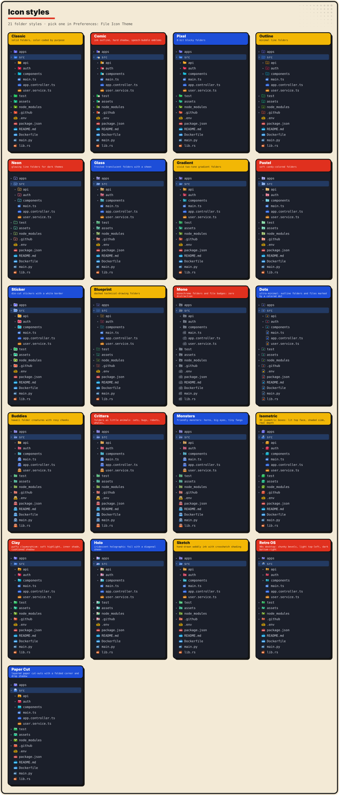
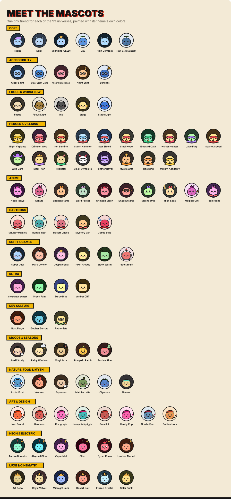
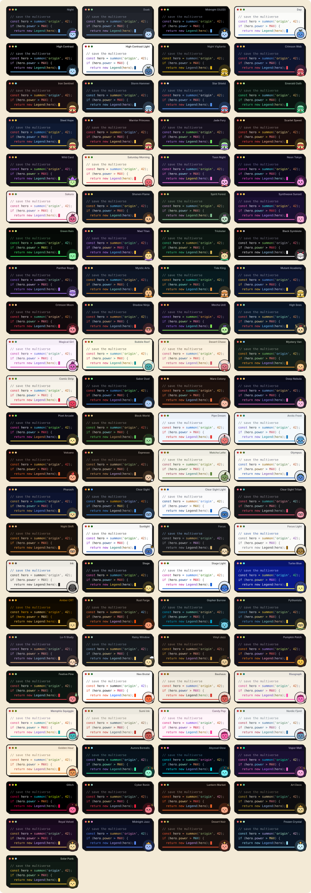

<p align="center">
  
</p>

<p align="center">
  <a href="https://marketplace.visualstudio.com/items?itemName=nuhmanpk.multiverse-theme"></a>
  <a href="https://marketplace.visualstudio.com/items?itemName=nuhmanpk.multiverse-theme"></a>
  <a href="https://github.com/nuhmanpk/multiverse-theme"></a>
  <a href="https://github.com/sponsors/nuhmanpk"></a>
</p>

<p align="center">
  <b>93 color themes, 21 icon styles, 93 mascots in one extension, plus the tools to use them.</b><br>
  Color-blind-safe and eye-care variants, focus and presentation modes, retro IDEs,<br>
  heroes, anime and cartoons. Every variant is contrast-checked so code stays readable.
</p>

---

## What's different

Most theme packs give you one look. Multiverse is built around what developers actually need:

| Need | Multiverse gives you |
|---|---|
| "I'm color blind and red/green diffs are useless" | **Clear Sight** variants, verified by a deuteranopia/protanopia/tritanopia simulation in CI |
| "My eyes hurt at 2am" | **Night Shift**: amber and red only, no blue light |
| "I code outside / by a window" | **Sunlight**: pure white with deep, saturated ink |
| "Syntax highlighting is a rainbow; I can't focus" | **Focus**: only definitions, strings, constants and comments stand out |
| "My code is unreadable on the projector / stream" | **Stage** and **Stage Light**: colors that survive video compression and washed-out projectors |
| "I want a fresh look without hunting for themes" | **Random**, **Daily** and **Scheduled** universes, plus a live-preview picker |
| "Light by day, dark by night, automatically" | `multiverse.schedule`, e.g. Day at 07:00, Lo-fi Study at 18:00, Night Shift at 23:00 |

## Commands

| Command | Shortcut | What it does |
|---|---|---|
| **Multiverse: Pick a Universe** | ⌃⌘M / Ctrl+Alt+M | Grouped picker. Moving with ↑↓ previews each variant live; Esc reverts. |
| **Multiverse: Random Universe** | ⌃⌘R / Ctrl+Alt+R | Jump to a random variant (filter by group or light/dark) |
| **Multiverse: Next / Previous Universe** | | Step through every variant |
| **Multiverse: Today's Universe** | | One variant per day, the same all day |
| **Multiverse: Pick Folder Icon Style** | | 21 icon styles, with live preview |

The status bar shows the current universe. Click it to switch.

### Settings

```jsonc
// Auto-switch by time of day (takes priority over dailyUniverse)
"multiverse.schedule": { "07:00": "Day", "18:00": "Lo-fi Study", "23:00": "Night Shift" },

// Or: a new universe every day
"multiverse.dailyUniverse": true,

// Limit Random / Daily to some groups, or to dark only
"multiverse.randomPool": ["Heroes & Villains", "Anime"],
"multiverse.randomKinds": ["dark"],

"multiverse.statusBar": true
```

## File & folder icons

The extension includes **21 file-icon styles**. They are generated from one data file, so every style covers the same files and folders.

| Family | Styles |
|---|---|
| **Essentials** | Classic, Outline, Mono (monochrome everything), Dots (ultra-minimal) |
| **Pop** | Comic, Pixel, Neon, Sticker, Pastel, Gradient, Glass, Blueprint |
| **Characters** 🧸 | **Buddies** (kawaii folder creatures), **Critters** (cats, bugs, robots, whales, owls…), **Monsters** (horns, big eyes, tiny fangs) |
| **Premium** ✨ | **Isometric** 3D, **Clay**, **Holo** foil, **Sketch**, **Retro OS**, **Paper Cut** |

- **325 file types**, covering **1,863 extensions** and **1,537 special file names**. Coverage is checked against GitHub Linguist's full language list:
  - every mainstream and niche language, from Fortran and COBOL to Zig, Gleam, Mojo and Lean
  - templates, shaders, query languages and diagrams
  - certificates and keys, office and media files
  - lockfiles for every package manager
  - IDE project files, dotfiles and framework configs
  - AI files: `CLAUDE.md`, `AGENTS.md`, `.cursorrules`, `mcp.json`, `*.prompt`
- **Framework-aware badges:** NestJS/Angular role files get their own badge, so `*.controller.ts` → **CTL**, `*.service.ts` → **SVC**, `*.module.ts` → **MOD** and `*.dto.ts` → **DTO**.
- **40 folder kinds** are recognized from **753 folder names**, including `src`, `api`, `auth`, `test`, `ai`, `.claude`, `src-tauri`, `.venv` and `node_modules`.

To pick a style, run **Multiverse: Pick Folder Icon Style** (it previews live), or use **⌘K ⌘T → File Icon Theme**.

> All icons are original artwork. Language badges are text labels, not official logos.

## Icon gallery

Every icon style, side by side in a real explorer tree:



Every file icon and folder kind. Both images are regenerated from `icons/` on each build, so they always match what ships:



## Meet the mascots

Every universe comes with a tiny friend, painted in that theme's own colors:

- heroes in capes and masks
- anime kids with sparkly eyes
- CRT-headed retro bots
- a crab, a gopher and a snake for Dev Culture
- a pumpkin, a rain cloud and a lo-fi coffee buddy for the moods

They show up in the theme picker too, so you can find your universe by its mascot.



## Install

1. Search for **Multiverse Theme** in the Extensions view, or run `code --install-extension nuhmanpk.multiverse-theme`.
2. Press **⌘K ⌘T** (Ctrl+K Ctrl+T on Windows/Linux).
3. Type `Multiverse` and pick a variant.

## The gallery

<p align="center"></p>

## All 93 variants

> The variant names and palettes are original works inspired by genres and color moods. They are not affiliated with or endorsed by any studio or publisher.

### ♿ Accessibility (5)
| Variant | For | Type |
|---|---|---|
| Clear Sight | deuteranopia / protanopia (blue–orange axis, no red-vs-green meaning) | dark |
| Clear Sight Light | the same, light | light |
| Clear Sight Tritan | tritanopia (red–teal axis) | dark |
| Night Shift | late nights: amber and red only, no blue light | dark |
| Sunlight | glare and outdoor screens: maximum ink on pure white | light |

> **Verified, not claimed.** `npm run check` simulates color-vision deficiency (Machado 2009) and fails the build if keywords, functions, strings, numbers, or diff added/removed become indistinguishable (ΔE < 12).

### 🎯 Focus & Workflow (5)
| Variant | For | Type |
|---|---|---|
| Focus | minimal highlighting: only what matters stands out | dark |
| Focus Light | the same, light | light |
| Ink | e-ink / paper: monochrome, comments in blue pencil | light |
| Stage | streaming and screen share: survives compression | dark |
| Stage Light | projectors and classrooms | light |

### 🦸 Heroes & Villains (18)
| Variant | Vibe |
|---|---|
| Night Vigilante | caped detective: black, steel, signal yellow |
| Crimson Web | wall-crawler: deep navy, web red, hero blue |
| Iron Sentinel | powered armor: hot-rod red, gold, arc-reactor cyan |
| Storm Hammer | god of thunder: storm slate, lightning, red cape |
| Star Shield | super-soldier: navy, star white, stripe red |
| Steel Hope | last son of a lost planet: cape red, suit blue, crest yellow |
| Emerald Oath | power ring: void black, emerald light |
| Warrior Princess | amazon warrior: crimson, gold, star blue |
| Jade Fury | gamma temper: torn purple, rage green |
| Scarlet Speed | fastest one alive: scarlet, lightning gold |
| Wild Card | chaos clown: purple suit, acid green |
| Mad Titan | cosmic conqueror: purple, golden gauntlet, six gems |
| Trickster | god of mischief: emerald cloak, gold horns |
| Black Symbiote | alien goo: ink black, white sigil |
| Panther Royal | jungle king: night black, royal purple glow |
| Mystic Arts | sorcerer: blue cloak, orange spell rings |
| Tide King | ocean ruler: deep sea, orange scales |
| Mutant Academy | gifted school: blue-and-gold uniforms |

### 🌸 Anime (10)
| Variant | Vibe | Type |
|---|---|---|
| Neon Tokyo | cyberpunk: rain-black, magenta, cyan | dark |
| Sakura | slice-of-life: cherry-blossom paper | light |
| Shonen Flame | battle anime: orange energy, sky-blue aura | dark |
| Spirit Forest | hand-painted fantasy: moss, sky, lanterns | dark |
| Crimson Moon | demon hunters: blood moon, checkered haori | dark |
| Shadow Ninja | hidden village: night navy, scroll red | dark |
| Mecha Unit | giant robot: violet armor, neon green | dark |
| High Seas | pirate adventure: ocean blue, straw gold | dark |
| Magical Girl | transformation sparkle: pastel | light |
| Toon Night | candy colors on grape | dark |

### 📺 Cartoons (5)
| Variant | Vibe | Type |
|---|---|---|
| Saturday Morning | bold primaries on cream paper | light |
| Bubble Reef | undersea: sunny yellow, lagoon teal | light |
| Desert Chase | canyon sand, sky, dynamite red | light |
| Mystery Van | van green, ascot orange | dark |
| Comic Strip | Sunday funnies: newsprint, halftone CMYK | light |

### 🚀 Sci-fi & 🎮 Games (6)
| Variant | Vibe | Type |
|---|---|---|
| Saber Duel | space knights: red vs blue blades | dark |
| Mars Colony | rust dust, habitat white | dark |
| Deep Nebula | nebula pink, star blue | dark |
| Pixel Arcade | 8-bit cabinet, sprite colors | dark |
| Block World | voxel survival: grass, dirt, diamond | dark |
| Pipe Dream | platformer: sky, brick red, pipe green | light |

### 📟 Retro (4)
| Variant | Vibe |
|---|---|
| Synthwave Sunset | 80s grid, sunset pink and orange |
| Green Rain | phosphor hacker terminal |
| Turbo Blue | 90s DOS IDE: blue screen, yellow and white text |
| Amber CRT | monochrome amber terminal |

### 🛠 Dev Culture (3)
| Variant | Vibe |
|---|---|
| Rust Forge | crab-orange forge, tuned for lifetimes and macros |
| Gopher Burrow | cyan mascot, tan burrow |
| Pythonista | snake blue and yellow, decorators pop |

### 🎧 Moods & Seasons (5)
| Variant | Vibe |
|---|---|
| Lo-fi Study | late-night beats: dusty lavender, warm lamp |
| Rainy Window | grey rain, streetlight yellow, neon sign |
| Vinyl Jazz | smoky club: walnut, brass, velvet |
| Pumpkin Patch | spooky season: night purple, jack-o'-lantern |
| Festive Pine | winter holidays: pine, berry red, candle gold |

### 🌋 Nature, Food & Myth (6)
| Variant | Vibe | Type |
|---|---|---|
| Arctic Frost | glacier: snow, ice blue, aurora | light |
| Volcano | basalt black, lava orange | dark |
| Espresso | dark roast, crema | dark |
| Matcha Latte | oat milk, matcha, red bean | light |
| Olympus | marble, laurel gold, Aegean blue | light |
| Pharaoh | lapis, gold leaf, turquoise | dark |

### 🎨 Art & Design (8, all light)
| Variant | Vibe |
|---|---|
| Neo Brutal | stark white, pure black ink, one loud hazard orange |
| Bauhaus | primaries on unbleached canvas |
| Risograph | two-tone print: fluorescent pink and federal blue |
| Memphis Squiggle | 80s postmodern confetti: teal, pink, yellow |
| Sumi Ink | ink-wash on rice paper with a red seal stamp |
| Candy Pop | bubblegum, grape soda, sour apple |
| Nordic Fjord | birch white, fjord blue, lingonberry |
| Golden Hour | honey light, dusty rose, long shadows |

### ⚡ Neon & Electric (6)
| Variant | Vibe |
|---|---|
| Aurora Borealis | polar night lit by green-violet curtains |
| Abyssal Glow | bioluminescent deep sea |
| Vapor Mall | 1993 food court: teal tile, hot pink, marble bust |
| Glitch | RGB split, scanline black, dead-pixel white |
| Cyber Ronin | neon katana: lacquer black, blood red, circuit gold |
| Lantern Market | night market: paper lanterns, chili oil, jade |

### 🥂 Luxe & Cinematic (6)
| Variant | Vibe |
|---|---|
| Art Deco | onyx, gold leaf fans, emerald, champagne |
| Royal Velvet | plum velvet, ermine, crown gold, ruby |
| Midnight Jazz | indigo smoke, saxophone brass, neon sign |
| Desert Noir | burnt sienna sky, cactus, tail-light red |
| Frozen Crystal | ice palace: glacier blue, prism refractions |
| Solar Punk | rooftop gardens, solar gold, sky glass |

### ⚙️ Core (6)
Night · Dusk · Midnight (OLED) · Day · High Contrast (7:1) · High Contrast Light (7:1)

## Under the hood

- **Readable in every universe.** A build-time contrast guard adjusts any syntax color that falls below 4.5:1 (WCAG AA). High-contrast variants are held to 7:1 (AAA).
- **Covers the whole window.** Each variant themes 245 parts of VS Code: tabs, sidebars, terminal (all 16 ANSI colors), diff and merge views, debug, testing, minimap, inlay hints and bracket pairs.
- **Semantic highlighting.** TypeScript, Rust, Go, Python, C# and Java get language-server-accurate colors.
- **Language-specific polish.** JSX components are colored differently from HTML tags. Nested JSON keys get different colors per level. Also covered: Python `self` and f-strings, Rust macros and lifetimes, SQL, Markdown and diffs.

## Auto light/dark switching

```jsonc
"window.autoDetectColorScheme": true,
"workbench.preferredDarkColorTheme": "Multiverse Neon Tokyo",
"workbench.preferredLightColorTheme": "Multiverse Sakura"
```

## Make your own variant

Add about 10 lines to `scripts/palettes.mjs`:

```js
myhero: derive('My Hero', 'dark', {
  bg: '#101820', fg: '#e8eef5', accent: '#ff5a5f',
  keyword: '#ff5a5f', func: '#5fb4ff', string: '#ffd23f', number: '#ff9e58',
  type: '#8ad0ff', constant: '#ff8a8e', param: '#c5d3f0',
}),
```

`npm run build` regenerates the themes, `package.json` and the artwork. The contrast guard fixes any colors that are too faint. PRs with new universes are welcome.

## Develop

```sh
npm run check     # WCAG contrast + color-blindness audit of every variant
npm run build     # themes/*.json + package.json + images
npm run package   # check + build + .vsix
```

## Support

If Multiverse makes your editor more fun, consider supporting it:

- ⭐ Star the repo: [github.com/nuhmanpk/multiverse-theme](https://github.com/nuhmanpk/multiverse-theme)
- ❤️ Sponsor: [github.com/sponsors/nuhmanpk](https://github.com/sponsors/nuhmanpk)
- 🐛 Report issues or request a universe: [Issues](https://github.com/nuhmanpk/multiverse-theme/issues)

Made by [@nuhmanpk](https://github.com/nuhmanpk). MIT License.
